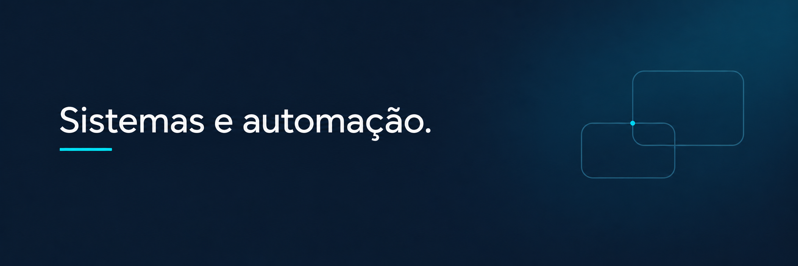

  

Projetos de suporte de TI, sistemas internos e automação de rotinas.

## Sistemas internos

| Projeto | Contribuições |
| :--- | :--- |
| **Consulta de Reprocessos** | Consulta de histórico e rastreabilidade de registros do ERP. |
| **Inventário de TI** | Desenvolvimento de cadastro de ativos, responsáveis e movimentações. |
| **Gestão de Computadores** | Evolução de desligamentos agendados e manuais, diagnóstico e logs. |
| **Romaneios e Logística** | Melhorias em cadastro, consulta, impressão e despacho. |
| **Sistemas Legados** | Manutenção, correções de interface e apoio à instalação e configuração do ERP. |

[Conhecer as contribuições e o escopo dos projetos →](docs/projetos/sistemas-internos.md)

## Outros projetos

- **[Monitor de Sinais](docs/projetos/monitor-de-sinais.md)** — simulador e visualização local com entrada serial. Python e Qt. [Código](https://github.com/NGK-999/InterfaceNeural).
- **[coolleo-display-linux](docs/projetos/coolleo-display-linux.md)** — integração experimental de telemetria com um display USB no Linux. Python e Shell. [Código](https://github.com/NGK-999/coolleo-display-linux).
- **[Horizonte](docs/projetos/horizonte.md)** — visualização interativa de um buraco negro no navegador. TypeScript, Three.js e WebGL. [Código](https://github.com/NGK-999/horizonte-buraco-negro).

## Conhecimentos

Suporte a usuários e sistemas, Windows Server, Active Directory e Hyper-V. Fundamentos de JavaScript, C++ e SQL em estudo e prática.

Desenvolvimento e aprendizado com apoio de ferramentas de IA.
