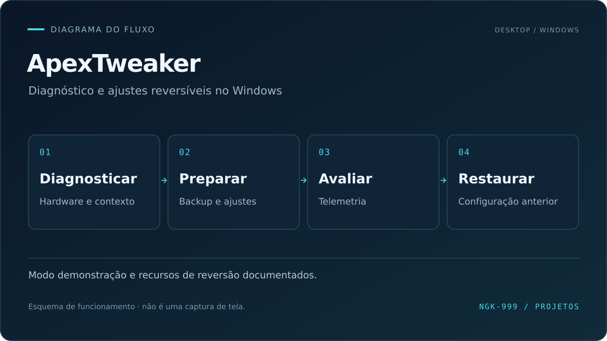
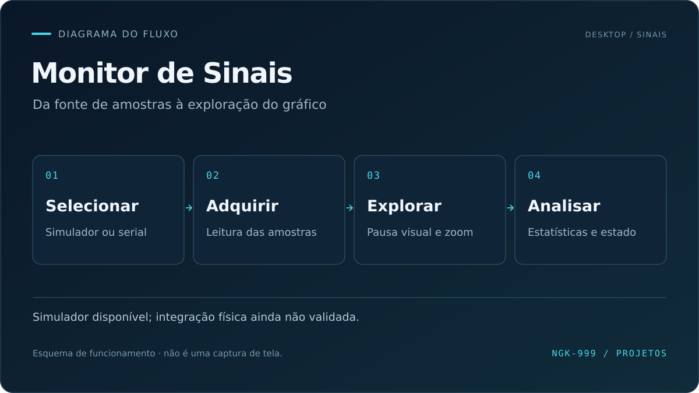
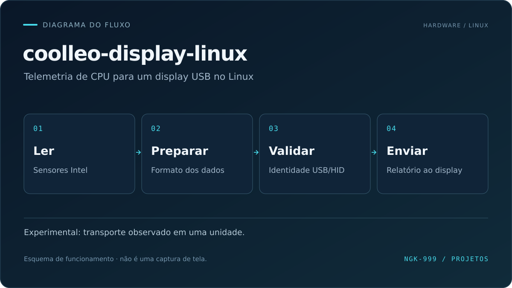
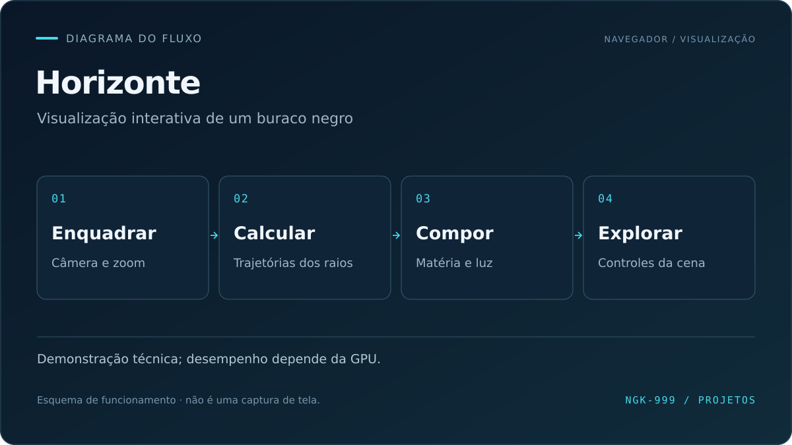

  

Aplicações desktop, integração com hardware e visualização no navegador. Quatro projetos com apresentações sobre objetivo, funcionamento, decisões técnicas e validação.

## Projetos em destaque

<table>
  <tr>
    <td width="50%" valign="top">
      <h3>01 · ApexTweaker</h3>
      

      
Diagnóstico e ajustes reversíveis do Windows, com telemetria, modo demonstração e recursos para Minecraft.

      
C# · .NET · WPF

      
<a href="docs/projetos/apextweaker.md"><strong>Conhecer projeto →</strong></a>

      
<a href="https://github.com/NGK-999/tweaker">Código</a> · <a href="https://github.com/NGK-999/tweaker/blob/main/docs/README.md">Documentação</a>

    </td>
    <td width="50%" valign="top">
      <h3>02 · Monitor de Sinais</h3>
      

      
Simulador e visualização local de sinais com entrada serial. Validação com hardware físico pendente.

      
Python · Qt · Comunicação serial

      
<a href="docs/projetos/monitor-de-sinais.md"><strong>Conhecer projeto →</strong></a>

      
<a href="https://github.com/NGK-999/InterfaceNeural">Código</a> · <a href="https://github.com/NGK-999/InterfaceNeural/blob/main/docs/verificacao.md">Validação</a>

    </td>
  </tr>
  <tr>
    <td width="50%" valign="top">
      <h3>03 · coolleo-display-linux</h3>
      

      
Telemetria de CPU Intel para um display USB no Linux. Projeto experimental, com suporte a um dispositivo específico.

      
Python · Shell · Linux · USB HID

      
<a href="docs/projetos/coolleo-display-linux.md"><strong>Conhecer projeto →</strong></a>

      
<a href="https://github.com/NGK-999/coolleo-display-linux">Código</a> · <a href="https://github.com/NGK-999/coolleo-display-linux/blob/main/README.pt-BR.md">Guia em português</a>

    </td>
    <td width="50%" valign="top">
      <h3>04 · Horizonte</h3>
      

      
Demonstração interativa de um buraco negro no navegador, com câmera livre e matéria procedural.

      
TypeScript · Three.js · WebGL

      
<a href="docs/projetos/horizonte.md"><strong>Conhecer projeto →</strong></a>

      
<a href="https://github.com/NGK-999/horizonte-buraco-negro">Código</a> · <a href="https://github.com/NGK-999/horizonte-buraco-negro#executar-localmente">Como executar</a>

    </td>
  </tr>
</table>

## Conhecimentos e prática

| Área | Foco |
| :--- | :--- |
| **Tecnologias presentes nos projetos** | C#, .NET, WPF, Python, Qt, TypeScript, Three.js, WebGL e Shell. |
| **Aplicações práticas** | Interfaces desktop, leitura serial, telemetria, integração USB e visualização interativa. |
| **Suporte e infraestrutura** | Suporte a usuários e sistemas, Windows Server, Active Directory e Hyper-V. |
| **Programação manual básica** | Fundamentos de JavaScript, C++ e SQL, em estudo e prática. |

Projetos desenvolvidos com apoio de ferramentas de IA. As tecnologias dos repositórios descrevem o que foi utilizado; o domínio de programação está em desenvolvimento.
